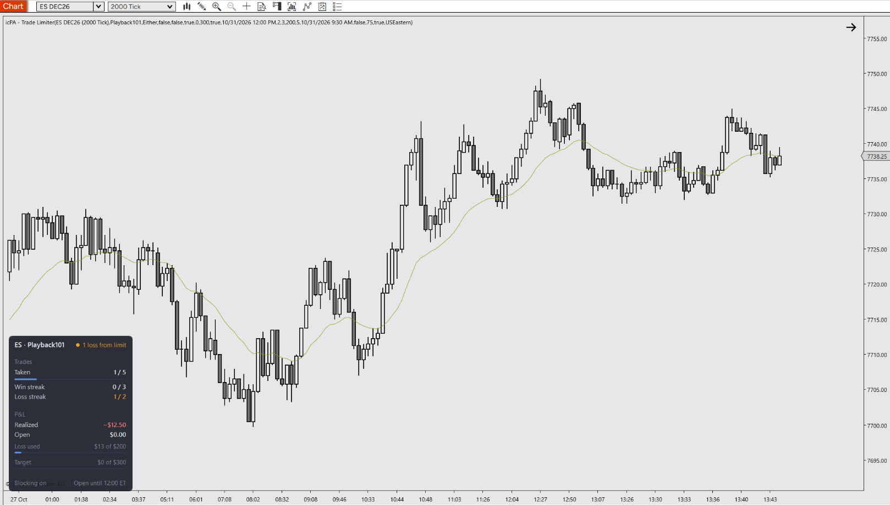

# icPA - Trade Limiter for NinjaTrader 8

A specialized Indicator engineered for Price Action day trading. It tracks your own fills on the selected account and shows your trade count, win/loss streaks and realized P&L against your daily limits in an on-chart dashboard, warns you before a limit is hit, and can optionally block new entries once you should stop.

---

## 📺 Video Walkthrough & Setup

Watch the complete breakdown of parameters, price action context, and chart examples on YouTube:

> **[▶ Click here to watch the full YouTube walkthrough](https://youtube.com/@icPriceAction)**

---

## ☕ Support the Project

All tools by **icPriceAction** are **100% free and open-source for personal trading use**. There are no paywalls, subscriptions, or locked features and there never will be!

Developing, optimizing for zero latency on multiple charts/instruments, and maintaining documentation and releases takes a **considerable amount of personal time and ongoing effort**. 

If this tool saves you screen time, improves your execution, or cleans up your charts, buying a coffee is the best way to support continued development:

  

> **[☕ Support Development on Buy Me a Coffee](https://buymeacoffee.com/icpriceaction)**

---

## ⚡ Key Features

- **Session Limits From Your Real Fills:** Counts completed trades, consecutive wins and losses, and realized P&L (commissions included) from the account's executions for this instrument, or uses the account-wide realized P&L. Limits use closed-trade P&L only; open P&L is shown for information and turns amber if closing now would breach your max daily loss.
- **Early Warnings, Cooldown & Trade Window:** Amber warning and sound when you are one trade or one loss from a limit, or when a set percentage of the max daily loss is used. Optional cooldown after each losing trade with a countdown, and an optional trading-hours window with its own time zone (daylight saving handled, follows the Playback clock).
- **Optional Entry Blocking (Never Closes Your Position):** When enabled, new entry orders are cancelled after the daily limit, during a cooldown or outside the trade window. A market entry that fills before it can be cancelled is offset by exactly its own quantity. Positions you already hold and their exits are never touched. When a limit is reached, the chart dims behind a clear on-chart message.
- **PATS & Context Aligned:** Designed for Price Action principles and disciplined futures execution.
- **Zero Chart Lag:** Native C# execution optimized to prevent UI freezes on high-frequency tick charts.
- **Clean Visuals:** Complementary default palette that preserves candlestick clarity without chart clutter.
- **Fully Customizable:** Configure colors, thresholds, offsets, and alerts via the native NT8 settings panel.

---

## ⚠️ Prerequisites & Data Requirements

- **Calculate: On Each Tick** (the default) is recommended. On Bar Close still enforces limits from your fills, but Open P&L and the session reset only update when a bar closes.
- A **connected account** is required. Tracking starts when the chart goes real-time and includes today's earlier fills for the instrument.
- **Entry blocking places and cancels orders on your account.** All blocking options are off by default. Test them in the **Sim** accounts or **Playback** mode before enabling them on a live account. An offset market order costs commission and slippage.
- Use only one copy per account and instrument setup you intend to enforce, and remove any older private version of this tool from your charts first.

---

## 📥 Installation Guide

1. Head to the **[Releases](https://github.com/icPriceAction/trade-limiter/releases)** tab of this repository.
2. Download the latest release `.zip` file.
   - *Note: Do NOT extract or unzip the file.*
3. Open **NinjaTrader 8**.
4. In the Control Center, navigate to:
   `Tools` ➔ `Import` ➔ `NinjaScript Add-On...`
5. Select the downloaded `.zip` file and click **Open**.
6. A success dialog will appear confirming the tool has been imported.
7. Open any chart, press `Ctrl + I`, find **icPA - Trade Limiter** in the **icPA** folder, and add it.

---

## ⚙️ Parameters & Configuration

| Parameter | Group | Type | Default | Description |
| :--- | :--- | :--- | :--- | :--- |
| Account Name | 1. General | Account | Sim101 | The account whose fills are tracked (and whose new entry orders are blocked when blocking is on). |
| Limit Mode | 1. General | Quantity / Dollar / Either | Either | Quantity: trade count and streak limits only. Dollar: max daily loss and profit target only. Either: whichever limit is hit first. |
| Use Account-Wide PnL | 1. General | Bool | False | Off: P&L from this instrument's fills this session. On: the account's total realized P&L (all instruments, NinjaTrader's reset schedule). |
| Enable Trade Window | 1. General | Bool | False | Only allow trading between the start and end time. |
| Start Time | 1. General | Time | 09:30 | When you are allowed to begin trading (in the window time zone). |
| End Time | 1. General | Time | 12:00 | When you must stop trading (in the window time zone). |
| Window Time Zone | 1. General | List | USEastern | Time zone of the start and end times (US Eastern, US Central, US Pacific, London, Central Europe, Tokyo, Sydney, or your NinjaTrader setting). Daylight saving is handled automatically. |
| Block Entries After Limit | 1. General | Bool | False | After the daily limit, cancel new entry orders for the rest of the session. A market entry that fills first is offset. Held positions are never closed. |
| Block Entries Outside Window | 1. General | Bool | False | Outside the trade window, cancel new entry orders. Needs the trade window enabled. |
| Block Entries During Cooldown | 1. General | Bool | False | During the cooldown after a loss, cancel new entry orders. Needs Cooldown Minutes above 0. |
| Show Dashboard Box | 2. Visuals | Bool | True | Toggle the dashboard on or off. |
| Theme | 2. Visuals | Dark / Light / Custom | Dark | Dashboard colour theme. Custom uses the two custom colours below. |
| Box Location | 2. Visuals | List | BottomLeft | Where the dashboard sits: top or bottom, left, center or right. |
| Start Compact | 2. Visuals | Bool | False | Start with only the header visible. Click the header to collapse or expand. |
| Custom Background | 2. Visuals | Brush | #D8DADC | Dashboard background colour when Theme is Custom. |
| Custom Text | 2. Visuals | Brush | #111213 | Dashboard text colour when Theme is Custom. |
| Font Size | 2. Visuals | Int (9–24) | 12 | Base font size for the dashboard. |
| Background Opacity | 2. Visuals | Int (0–100) | 92 | Dashboard background opacity in % (text stays fully opaque). |
| Dim Chart When Blocked | 2. Visuals | Bool | True | Darken the chart behind the on-chart message when the limit is reached, during a cooldown, or outside the trade window. |
| Dim Opacity | 2. Visuals | Int (10–95) | 60 | How dark the chart gets when trading is blocked (%). |
| Max Total Trades | 3. Offsets & Thresholds | Int (≥ 1) | 5 | Maximum completed trades allowed per session. |
| Max Consecutive Wins | 3. Offsets & Thresholds | Int (≥ 1) | 3 | Stop trading after this many wins in a row. |
| Max Consecutive Losses | 3. Offsets & Thresholds | Int (≥ 1) | 2 | Stop trading after this many losses in a row. |
| Max Daily Loss ($) | 3. Offsets & Thresholds | Double (≥ 1) | 200 | Stop trading once realized losses reach this amount. |
| Daily Profit Target ($) | 3. Offsets & Thresholds | Double (≥ 1) | 300 | Stop trading once realized profit reaches this amount. |
| Cooldown Minutes | 3. Offsets & Thresholds | Int (0–240) | 0 | Pause for this many minutes after each losing trade, with a countdown. 0 = off. |
| Warn One From Limit | 4. Alerts | Bool | True | Amber warning when one trade or one loss away from a quantity limit. |
| Warn Before Win Limit | 4. Alerts | Bool | False | Also warn when one win away from the max consecutive wins. |
| Warn At Loss % | 4. Alerts | Int (0–99) | 75 | Amber warning when this % of the max daily loss is used. 0 = off. |
| Play Warning Sound | 4. Alerts | Bool | True | Play a sound when a new early warning appears. |

---

## 📝 Changelog

- **v2.3.2**              - Initial public release. Cleaned and optimized by icPriceAction.
- **v2.3.1**              - Loss cooldown with countdown and optional entry blocking; a blocked fill is undone only once across several charts; blocked limit-order cancels retry, plus a once-a-second sweep.
- **v2.3.0**              - Limits use realized P&L only (open P&L is display-only and turns amber when closing would breach the max loss); chart dimming; blocking-only enforcement that never closes held positions; optional win-streak warning; reason-coloured limit message; window follows the Playback clock.
- **v2.2.0**              - Redesigned dashboard (Dark/Light/Custom themes, compact mode, progress bars); trade window with its own time zone; early warnings with sound.
- **v2.1.0**              - Per-instrument session P&L from own fills (or account-wide P&L); session start from the trading session template; thread-safe state; latched limits; optional entry blocking after the limit and outside the trade window.

---

## 🐛 Bug Reports & Feature Requests

Found an issue or have an enhancement idea?
Please submit an issue on the [Issues tab](https://github.com/icPriceAction/trade-limiter/issues).

---

## License

Free for personal trading use. Commercial resale, redistribution, or repackaging is strictly prohibited. See [LICENSE](LICENSE).

---

## ⚖️ Disclaimer

Futures trading involves substantial risk of loss and is not suitable for every investor. All indicators, drawing tools, strategies, and documentation provided by **icPriceAction** are for educational and analytical purposes only. Nothing herein constitutes financial or investment advice. Automated strategies can lose money and may behave differently in live markets than in simulation or backtests.

NinjaTrader® is a registered trademark of NinjaTrader, LLC. icPriceAction is an independent developer with no official affiliation to NinjaTrader, LLC.